# Soplos Look Manager 3.0

The theme and layout manager of Soplos Linux Tyson (Plasma). A new program built on Tauri 2, Svelte 4 and Tailwind 3, in the style of the other Soplos 3.0 programs.

> `3.0.0`: first stable release, written for Plasma 6.

| 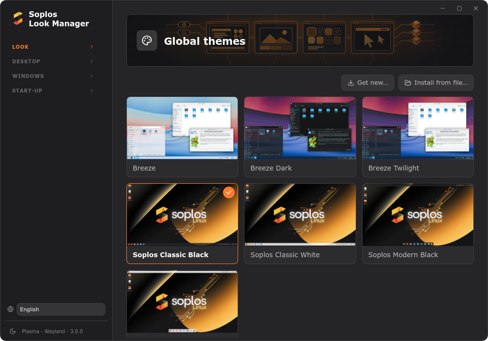 Global themes | 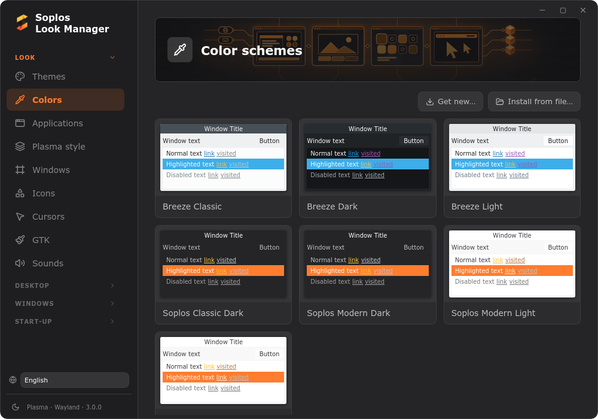 Color schemes |
|:---:|:---:|
| 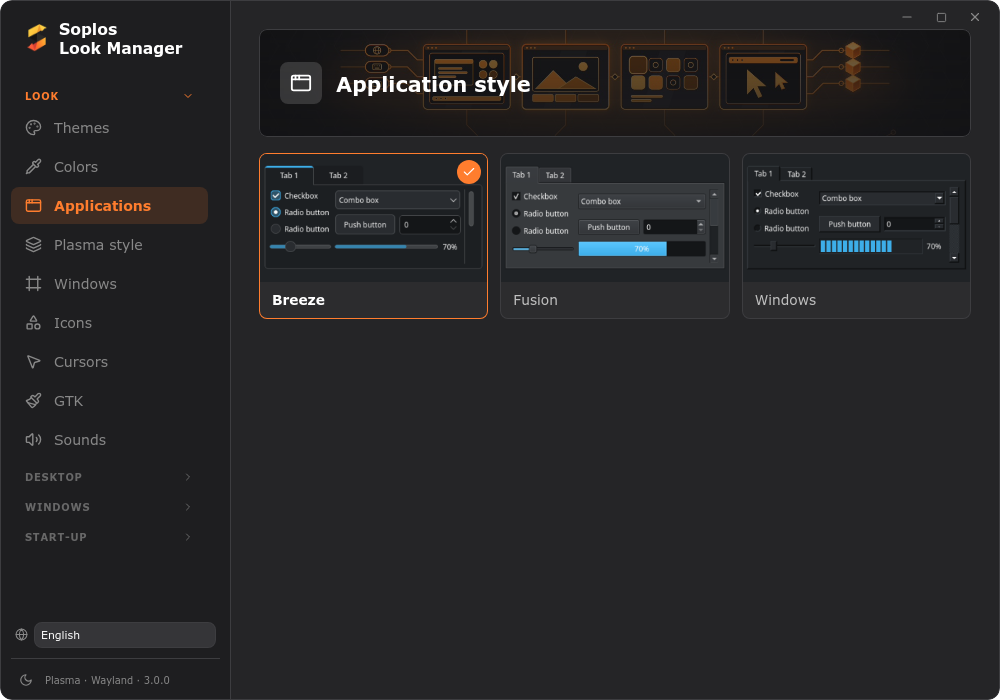 Application style | 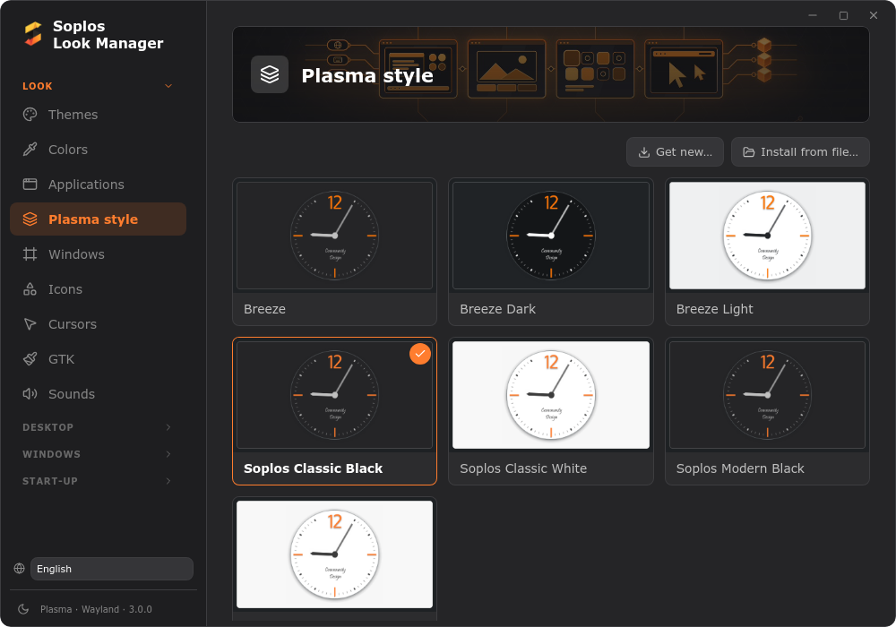 Plasma style |
| 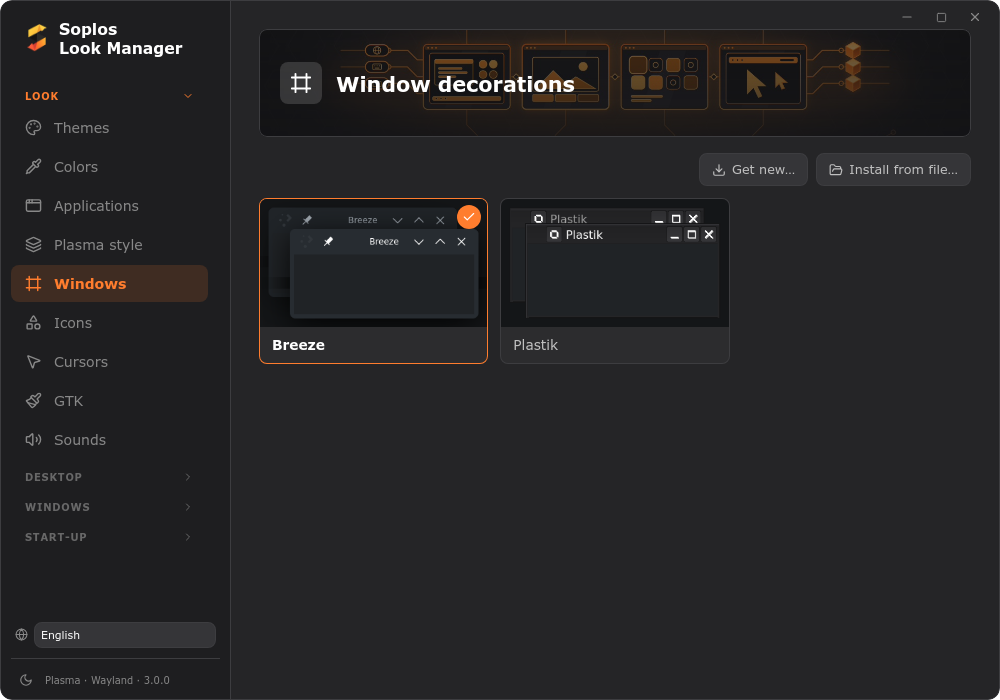 Window decorations | 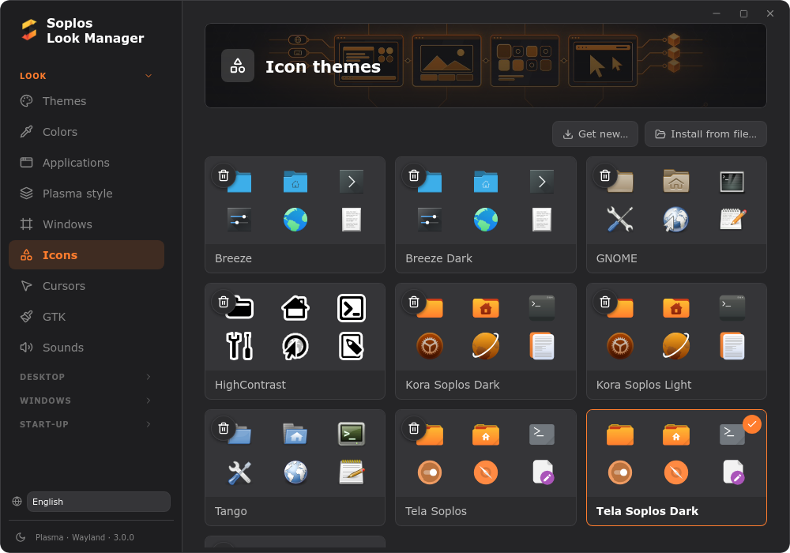 Icon themes |
| 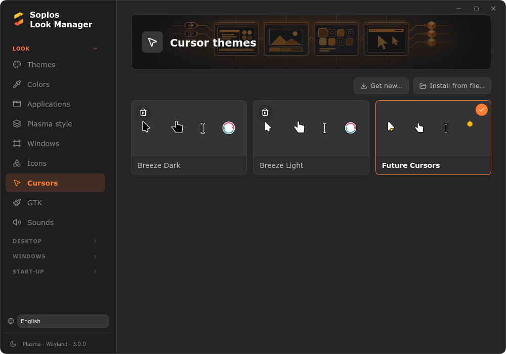 Cursor themes | 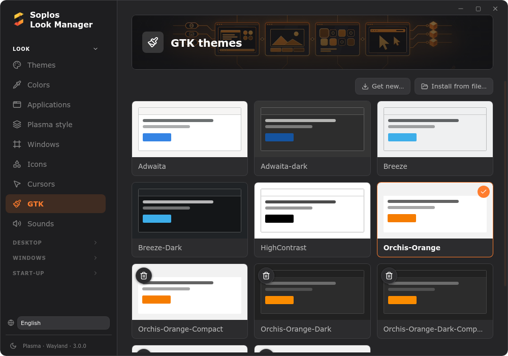 GTK themes |
| 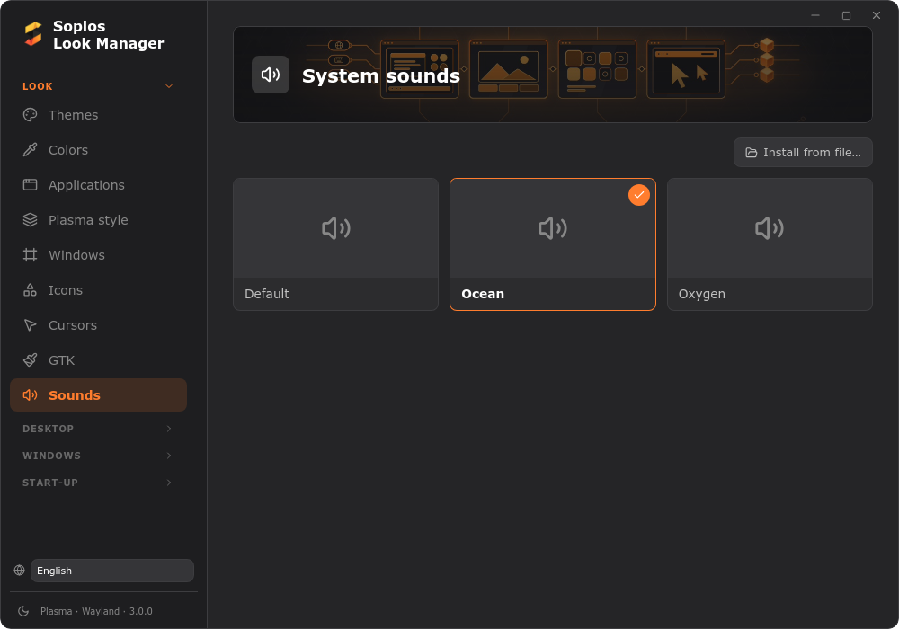 System sounds | 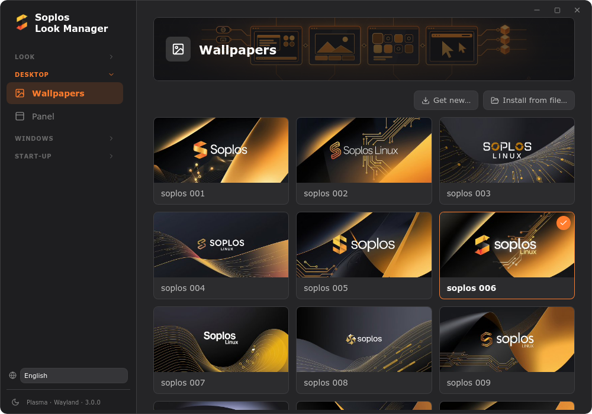 Wallpapers |
| 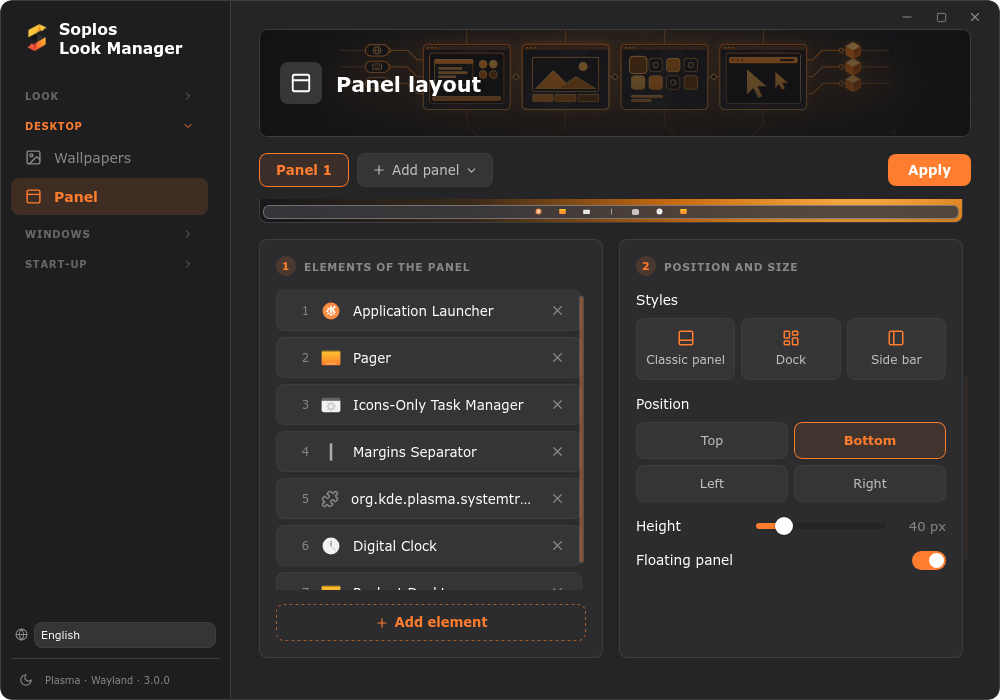 Panel layout | 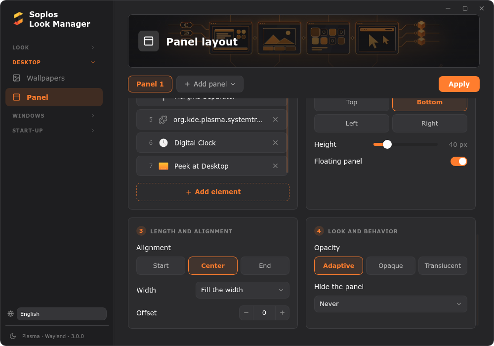 Panel options |
| 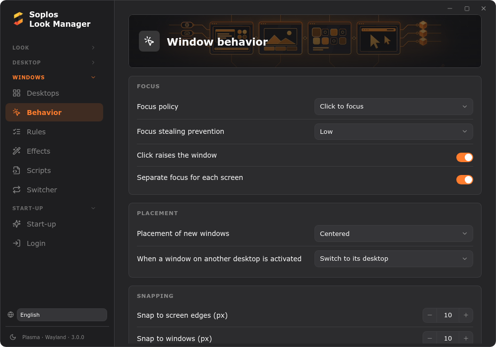 Window behavior | |

## Pages

| Page | What it does |
|------|--------------|
| Themes | Lists the global themes of Plasma, with a preview, and applies one |
| Wallpapers | Lists the wallpapers of the system and of the user, and applies one |
| Colors | Color schemes of Plasma, drawn with their colors |
| Application style | Style of the controls of the applications (Breeze, Fusion…) |
| Plasma style | Themes of the panel and the widgets |
| Window decorations | Plugins of KWin and themes of Aurorae |
| Sounds | Sound themes |
| Icons | Icon themes |
| Cursors | Cursor themes |
| GTK | GTK themes, for GTK 3, GTK 4 and libadwaita |
| Panel | Adds a panel (default, empty or menu bar) and removes it; puts elements on it (launcher, tasks, tray, clock...) and takes them off; position, height and floating, with classic, dock and side bar styles; alignment, width, offset, opacity and hiding under More options |
| Virtual desktops | Adds, renames and removes desktops; rows and cyclic navigation |
| Behavior | Focus, placement, snapping and mouse actions of the windows |
| Rules | Window rules: what is done to the windows that match a class and a title |
| Effects, Scripts | KWin desktop effects and scripts, on and off |
| Task switcher | Layout of Alt+Tab |
| Start-up | Start-up screens |
| Login | Picture of the login screen of Plasma Login Manager (asks for the administrator password) |

Shortcuts: F1 About, Ctrl+1 to Ctrl+9 the first nine pages, Ctrl+Tab the next page, Ctrl+Q quit.

## Development

```bash
npm install
npx tauri icon ../soplos-artwork/soplos-look-manager/soplos-look-manager.png
npm run tauri dev
```

The development server uses port 1433.

## License

GPL-3.0-or-later. Copyright © 2026 Sergi Perich.
